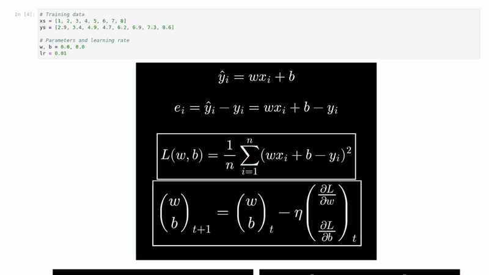

# Linear Regression From Scratch



This notebook builds linear regression from first principles using Python and
NumPy. It connects the geometry and mathematics of a fitted line to the actual
implementation: prediction, mean squared error, gradients, and batch gradient
descent.

## What's included

- [`linear_regression.ipynb`](linear_regression.ipynb) — a compact visual,
  mathematical, and programming walkthrough of linear regression from scratch.
- `linear_regression_scroll.gif` — an animated preview of the complete notebook.

## Open the notebook

Clone the repository, enter this directory, and launch Jupyter:

```bash
cd machine-learning/ml-from-scratch/1-linear-regression
jupyter notebook linear_regression.ipynb
```

Dependencies such as NumPy, Matplotlib, and Jupyter are the user's
responsibility.
