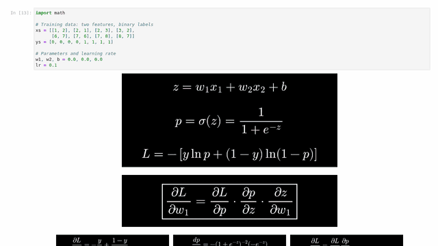

# Logistic Regression with SGD
This notebook builds logistic regression from scratch and trains it with stochastic gradient descent (SGD). It walks through the sigmoid function, binary cross-entropy, parameter updates, and the learned decision boundary.

