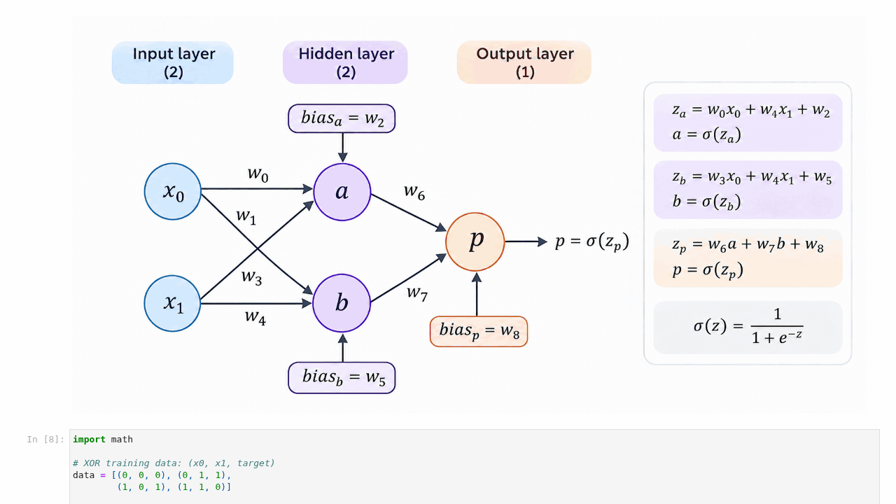

# XOR Neural Network with Backpropagation

<div align="center">
  
</div>

This notebook builds and trains a small neural network to learn XOR from scratch. It walks through the forward pass, stochastic gradient descent, backpropagation, and the learned decision surface.

## Files

- [`xor_neural_network_w_backprop.ipynb`](xor_neural_network_w_backprop.ipynb) — the complete notebook.
- [`xor_neural_network_w_backprop_scroll.gif`](xor_neural_network_w_backprop_scroll.gif) — an animated preview that scrolls from the top of the notebook to its bottom.

## Open the notebook

```bash
jupyter notebook xor_neural_network_w_backprop.ipynb
```

The notebook uses Python, NumPy, and Matplotlib.
