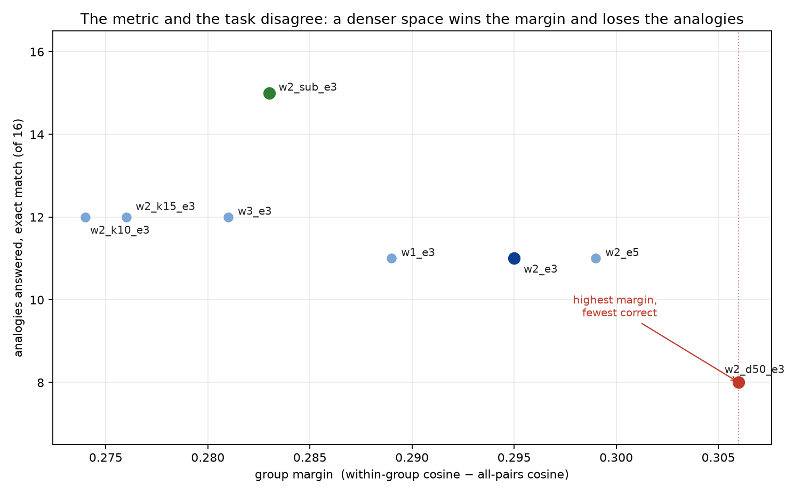
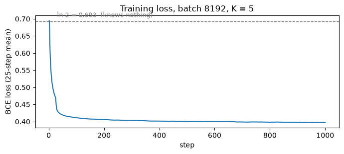
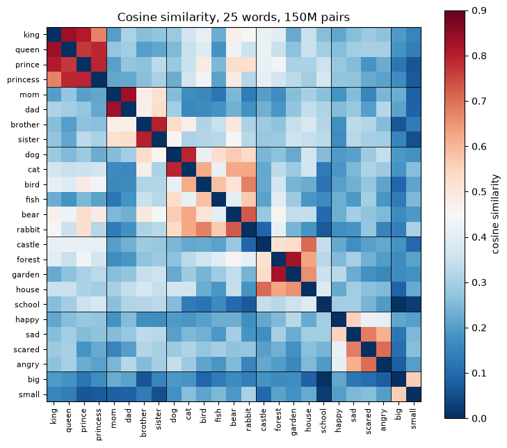

# Word Embeddings from Scratch

Word2Vec's skip-gram with negative sampling, written from first principles in PyTorch: no
`gensim`, no pretrained vectors, no `Word2Vec` import. A 20M-token corpus, 2.3M parameters, and
a notebook that prints evidence for every claim it makes.

```
raw text -> tokens -> vocabulary -> ids -> (center, context) pairs
         -> negatives -> skip-gram -> vectors -> nearest neighbours -> 3D map
```



## The result

| | |
|---|---|
| corpus | TinyStories, 20,104,405 tokens, 11,381 words (min_count 5, `<unk>` 0.07%) |
| model | skip-gram, dim 100, window 2, 5 negatives, 2,276,200 parameters |
| training | 18,310 steps × 8,192 pairs = 150M pairs, Adagrad lr 0.1, one GPU, 147 s |
| neighbours | `king → queen .84`, `dog → cat .79`, `rabbit → bunny .90`, `garden → backyard .91` |
| grouping | within-group cosine beats a random pair by **+0.295** (baseline 0.232) |
| analogies | 11/16 exact match — every miss is a near-synonym or a category-mate (`lady` for woman, `bounded` for jumped) |

The best model is not the one with the highest score on the metric the project itself built.
That is the most useful thing in this repository, and section "What the grid found" explains it.

## What is here

| file | role |
|---|---|
| `walkthrough.ipynb` | the ten-section walkthrough; every number in the prose is printed by the cell above it |
| `word_embeddings.py` | corpus, tokeniser, vocabulary, pair sampling, subsampling, negatives |
| `skipgram.py` | two embedding tables and a dot product |
| `train.py` | the training loop, checkpoints, and every knob as a CLI flag |
| `evaluate.py` | baseline, PC1, group margin, analogies, neighbour tables — one `metrics.json` per run |
| `grid.py` | the configuration grid, resumable |
| `kaggle/skipgram_kaggle.ipynb` | the same grid as a self-contained Kaggle notebook |
| `figures/` | the four charts used here |

`outputs/` holds the vectors the notebook reads. They are not committed: run
`python train.py --epochs 3 --window 2` and you get an equivalent model (CPU numerics differ
slightly from the GPU run behind the numbers below).

## Run it

```bash
python -m venv .venv && . .venv/bin/activate
pip install numpy torch matplotlib

python prepare_corpus.py                      # downloads TinyStories, writes 103 MB of text
python train.py --epochs 3 --window 2         # ~6 min on 4 CPU cores
jupyter lab walkthrough.ipynb                 # the evidence
```

`python grid.py` reproduces the whole comparison, but it is 1.3B pairs — a GPU job.

## How the model works

Two tables of 11,381 × 100 numbers: one for a word as the centre of a window, one for a word as
its context. A shared table would mix two different gradients, so there are two, as in Word2Vec.
The score of a pair is their dot product; the loss is binary cross-entropy over one real pair
(target 1) and K random ones (target 0). That is the entire supervision signal — no labels, no
dictionary, no annotation. The corpus is the teacher.

Two details that decide whether this trains at all:

**Initialisation.** PyTorch fills an embedding with `N(0, 1)`. In 100 dimensions the dot product
of two such vectors has a standard deviation near 10, `sigmoid` saturates, and the gradients are
dead on arrival. The Word2Vec box `U(-0.5/d, 0.5/d)` starts every score at zero, `sigmoid` at
0.5, and the loss at exactly `ln 2 = 0.693` — the value of maximal ignorance. The notebook prints
that number before training as proof, not as decoration.

**The optimiser.** Adam normalises every coordinate to a step of roughly `lr`, so any small
shared bias accumulates linearly and every vector ends up pointing the same way. Measured on
this data: PC1 held **97.6%** of the variance and every pair had cosine ≈ 1.00. Adagrad's
per-coordinate accumulator keeps the space spread out; PC1 drops to **5.2%**. Sparse gradients
with Adagrad also run about four times faster on CPU than dense Adam.



The loss starts at `ln 2` and falls fast, then slowly. It never reaches zero and should not: some
of the words drawn as negatives really do sit next to the centre word, so a perfect score would
be a model that has memorised the corpus.

## What the grid found

Seventeen runs, each scored on the same four numbers: a random-pair baseline, the share of
variance on PC1 (a collapse detector), the margin by which six hand-made word groups beat random
pairs, and sixteen analogies.

**A narrower window wins.** Window 2 beat window 5 on both margin and neighbour quality: tight
contexts capture syntax and morphology rather than topic. `walk → walked` and `cat → cats`
depend on adjacent words; "castle stories" and "dragon stories" do not.

**Subsampling did not pay off here.** Word2Vec's `1 - sqrt(t/f)` formula is built for corpora of
a billion tokens, where `the` is a large fraction of everything. At 20M tokens and 11k words it
removes real context: margin 0.229 vs 0.259 at equal pairs, 0.241 vs 0.282 at three passes. It
did improve exact-match analogies (15/16), because surviving rare words receive about three
times more updates — but its neighbours became collocations (`dog → rex, spot, wagged`) instead
of meanings (`dog → cat, puppy, wolf`).

**More dimensions hurt.** dim 200 and dim 300 landed at margin 0.204 and 0.187 with 11/16
analogies. Twenty million tokens do not support the parameters; the extra dimensions mostly add
noise.

**More negatives cost time and bought nothing.** K = 10 and K = 15 took 1.5× and 2.1× longer per
pair and moved accuracy by one question.

### The metric lied

The margin is `within-group cosine − all-pairs cosine`. It is supposed to be immune to
anisotropy, and it is not: compressing the space into one direction inflates both terms, but the
within-group term more. `dim 50` produced the **highest margin in the whole grid (0.306)** and
the **fewest correct analogies (8/16)**. A denser space scores better on a cosine-contrast metric
while being less useful.


That is why the model was chosen by inspecting neighbour tables, not by taking the argmax of a
number. The chosen run (`window 2`, no subsampling) is not the top of any single column. It has
the strongest canonical pairs (`king/queen 0.836`, `dog/cat 0.793`) and the most semantic
neighbour lists.

### Exact-match analogies are blind to synonyms

Four of the five misses of the chosen model keep the *relation* and pick a neighbouring word:
`queen − king + man → lady`, `walked − walk + jump → bounded`, `birds − bird + fish → frogs`,
`days − day + night → months`. `lady` is a synonym of `woman`; `bounded` is `jumped` in British
usage. Reporting "11/16" alone would have been a misleading headline, and reporting "15/16" for
the subsampled model would have been worse: the difference between the two is mostly which
synonym won the argmax.

## The 3D map

PCA fitted on **all 11,381** words (not on the 25 being displayed, which would produce a prettier
and more dishonest picture), then the 25 are plotted. PC1 holds 5.2% of the variance and the
first three hold 13.1% — four times what three arbitrary dimensions would. No direction
dominates, which is the healthy case; the collapsed model above had one component at 97.6%.

The obvious guess, that PC1 is frequency, is wrong: the correlation between PC1 and log frequency
is `r = 0.02`. The common direction is geometric, not a frequency artefact.



## What this is not

A POC for reading, not a production embedder. English only, ASCII tokeniser, 11k vocabulary, no
subword units, no out-of-vocabulary handling beyond `<unk>`. Everything here is measured on one
corpus of children's stories, and one of the lessons — that subsampling hurts — is a statement
about *that* corpus size, not a general claim.

## References

Mikolov et al., [*Efficient Estimation of Word Representations in Vector Space*](https://arxiv.org/abs/1301.3781) (2013) and
[*Distributed Representations of Words and Phrases*](https://arxiv.org/abs/1310.4546) (2013).
Corpus: Eldan & Li, [*TinyStories*](https://arxiv.org/abs/2305.07759) (2023).
