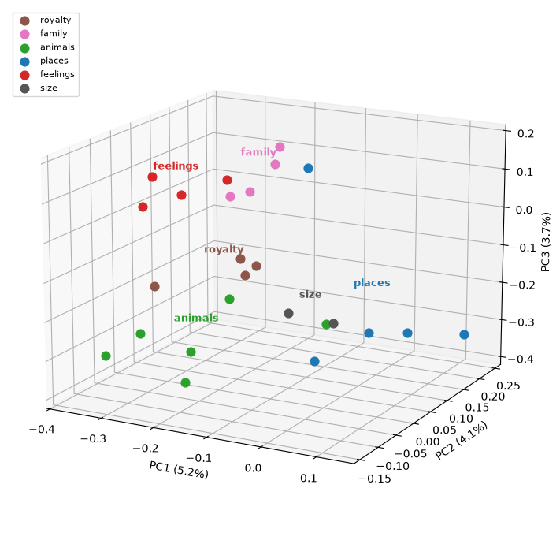

# Word Embeddings from Scratch

Word2Vec's skip-gram with negative sampling, written from first principles in PyTorch: no
`gensim`, no pretrained vectors, no `Word2Vec` import. A 20M-token corpus, 2.3M parameters, a
notebook that prints evidence for every claim it makes — and the trained weights, ready to load.

```
raw text -> tokens -> vocabulary -> ids -> (center, context) pairs
         -> negatives -> skip-gram -> vectors -> nearest neighbours -> 3D map
```

**One-page summary:** open [`index.html`](index.html) in a browser — the whole story with the
charts and a link to the rotatable map, no notebook required.



## The result

| | |
|---|---|
| corpus | TinyStories, 20,104,405 tokens, 11,381 words (min_count 5, `<unk>` 0.07%) |
| model | skip-gram, dim 100, window 2, 5 negatives, 2,276,200 parameters |
| training | 18,310 steps × 8,192 pairs = 150M pairs, Adagrad lr 0.1, one GPU, 147 s |
| neighbours | `king → queen .84`, `dog → cat .79`, `rabbit → bunny .90`, `garden → backyard .91` |
| grouping | within-group cosine beats a random pair by **+0.295** (baseline 0.232) |
| analogies | 11/16, and the misses are near-synonyms (`lady` for woman, `bounded` for jumped) |

## The trained model

`outputs/` holds the weights, so the numbers above can be checked without training anything:

| file | what it is |
|---|---|
| `embeddings.npy` | 11,381 × 100 float32; row *i* is the vector for line *i* of `vocab.txt` |
| `vocab.txt` | one word per line, in id order — id 0 is `<unk>` |
| `metrics.json` | the numbers above, machine-readable |
| `embedding_map.html` | the interactive map, generated from this model |

**Use it:**

```python
import numpy as np

E = np.load("outputs/embeddings.npy")
words = open("outputs/vocab.txt", encoding="utf-8").read().split("\n")
U = E / np.linalg.norm(E, axis=1, keepdims=True)   # cosine = dot product

i, j = words.index("king"), words.index("queen")
print(U[i] @ U[j])                                  # 0.836
```

**Continue training:**

```bash
# warm start from the saved matrix: both tables begin from it
python train.py --init outputs/embeddings.npy --epochs 1 --out runs/warm

# or resume an exact checkpoint, if you kept one
# (train.py writes outputs/checkpoint.pt every 1,000 steps)
python train.py --resume
```

`--init` needs only the matrix. `--resume` needs the checkpoint, because it also restores the
optimiser state and both random number generators, and continues on exactly the same trajectory.

## What is here

| file | role |
|---|---|
| `walkthrough.ipynb` | ten sections, from raw text to the map; self-contained and Kaggle-ready — it defines every function it uses, trains its own 200-dim model on whatever device it finds (about 7 minutes on a GPU), and imports nothing from this repository |
| `word_embeddings.py` | corpus, tokeniser, vocabulary, pair sampling, negatives |
| `skipgram.py` | two embedding tables and a dot product |
| `train.py` | the training loop, checkpoints, and the knobs as CLI flags |
| `evaluate.py` | neighbours, analogies, the random-pair floor, one `metrics.json` |
| `make_page.py` | builds `index.html` from the trained vectors |
| `index.html` | the one-page summary |
| `figures/` | the charts used here and in the page |

## How it works

Two tables of 11,381 × 100 numbers: one for a word as the centre of a window, one for a word as
its context. A shared table would mix two different gradients, so there are two, as in Word2Vec.
The score of a pair is their dot product; the loss is binary cross-entropy over one real pair
(target 1) and five random ones (target 0). That is the whole supervision signal — no labels, no
dictionary, no annotation. The corpus is the teacher.

Two details decide whether this trains at all:

**Initialisation.** PyTorch fills an embedding with `N(0, 1)`; in 100 dimensions the dot product of
two such vectors has a standard deviation near 10, so `sigmoid` saturates and the gradients are
dead on arrival. The Word2Vec box `U(-0.5/d, 0.5/d)` starts every score at zero, `sigmoid` at 0.5,
and the loss at exactly `ln 2 = 0.693`. The notebook prints that number before training as proof.

**The optimiser.** Adagrad, not Adam. Adam normalises every coordinate to a step of roughly `lr`,
so a small shared bias accumulates linearly and the vectors collapse onto one direction; Adagrad
decays per coordinate and keeps the space spread out. Sparse gradients with Adagrad are also about
four times faster on CPU than dense Adam.

## Run it

```bash
python -m venv .venv && . .venv/bin/activate
pip install numpy torch matplotlib

python prepare_corpus.py      # downloads TinyStories, writes 103 MB of text
python train.py               # ~1 minute per 50M pairs on 4 CPU cores; three by default
python evaluate.py outputs    # neighbours, analogies, and the floor they beat
jupyter lab walkthrough.ipynb
python make_page.py           # rebuild index.html from the vectors
```

On a GPU add `--device cuda`. Every flag has a default that reproduces the model above, so
`python train.py` needs no arguments.

## What this is not

A POC for reading, not a production embedder. English only, ASCII tokeniser, 11k vocabulary, no
subword units, no out-of-vocabulary handling beyond `<unk>`. Everything is measured on one corpus
of children's stories.

## References

Mikolov et al., [*Efficient Estimation of Word Representations in Vector Space*](https://arxiv.org/abs/1301.3781) (2013) and
[*Distributed Representations of Words and Phrases*](https://arxiv.org/abs/1310.4546) (2013).
Corpus: Eldan & Li, [*TinyStories*](https://arxiv.org/abs/2305.07759) (2023).
